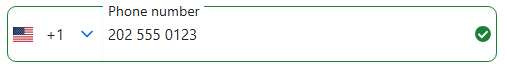

# react-country-dial-input

A polished telephone input for React with searchable countries, dial codes, adaptive number formatting, and built-in validation.


## Preview



## Try the demo

**[Open the live demo](https://devaidy.github.io/react-country-dial-input/)**

The interactive playground shows country selection, live validation, the national number value, and its E.164 result. Use the props panel to change component options, inspect the props object, and see callback events. It also includes custom format, masked, and disabled examples.

```bash
git clone https://github.com/devAIDY/react-country-dial-input.git
cd react-country-dial-input
npm install
npm run dev
```

Open the local URL printed by Vite, usually `http://localhost:5173/`.

## Features

- Search 243 countries by name, ISO code, or dial code, with flags.
- Format numbers according to the selected country's length, or provide a custom mask.
- Validate numbers and receive their E.164 representation.
- Support floating labels, masked input, disabled states, and custom addons.
- Theme the component with CSS variables; no UI framework required.
- Clean pasted numbers such as `+1 (555) 123-4567` into national digits.

## Install

```bash
npm install react-country-dial-input
```

Requires React 18 or newer. `flag-icons`, `phone`, and `react-number-format` are installed with the package.

## Quick start

Import the component styles and flag styles once in your app entry:

```jsx
import { useState } from "react";
import "flag-icons/css/flag-icons.min.css";
import "react-country-dial-input/style.css";
import TelephoneInput from "react-country-dial-input";

export default function PhoneField() {
  const [phone, setPhone] = useState("");
  const [country, setCountry] = useState("US");

  return (
    <TelephoneInput
      label="Phone number"
      name="phone"
      value={phone}
      countryCode={country}
      onChange={(event) => setPhone(event.target.value)}
      onCountryChange={(code) => setCountry(code)}
    />
  );
}
```

The input is controlled. `onChange` provides national digits without the dial code. `countryCode` is the selected ISO alpha-2 country code, such as `US` or `IN`.

By default, the mask adapts to the selected country. Pass `format` to provide your own mask using `#` for each digit:

```jsx
<TelephoneInput
  label="US phone number"
  countryCode="US"
  value={phone}
  onChange={(event) => setPhone(event.target.value)}
  format="(###) ###-####"
/>
```

The custom mask controls the displayed formatting; `onChange` still returns digits only. `unformatted` disables both the built-in and custom masks.

## Validation

Set `autoValidate` to validate as the user types. `onValidate` provides the validity and E.164 number for your form state:

```jsx
<TelephoneInput
  name="phone"
  value={phone}
  countryCode={country}
  onChange={(event) => setPhone(event.target.value)}
  onCountryChange={setCountry}
  autoValidate
  onValidate={(isValid, info) => {
    setPhoneValid(isValid);
    // info.phoneNumber is E.164, for example "+919876543210".
    // It is null when the number is invalid.
  }}
/>
```

`onValidate` also works without `autoValidate` if you want to manage the visual state yourself with `isValid` or `isInvalid`. Explicit `isValid` and `isInvalid` props take precedence over `autoValidate`.

You can validate outside the component too:

```js
import { validatePhone, getPhoneInfo } from "react-country-dial-input";

validatePhone("9876543210", "IN"); // true
validatePhone("07400123456", "GB"); // false: omit the domestic trunk prefix

getPhoneInfo("2025550123", "US");
// { isValid: true, phoneNumber: "+12025550123", countryIso2: "US",
//   countryIso3: "USA", countryCode: "+1" }
```

Validation uses the `phone` library's country rules for number length and valid prefixes. A leading domestic `0` is rejected except for Congo, Ivory Coast, and Benin, where numbers start with `0`. Jersey, Guernsey, and the Isle of Man use UK rules; Christmas and Cocos Islands use Australian rules; Saint Barthélemy and Saint Martin use Guadeloupe rules; Vatican City uses Italian rules.

## Props

| Prop | Type | Default | Description |
| --- | --- | --- | --- |
| `label` | `node` | — | Floating label. |
| `value` | `string` | `""` | National number, digits only. |
| `name` | `string` | — | Input name, included in the `onChange` event target. |
| `id` | `string` | `telephone_input_id_${name}` | Input id. |
| `countryCode` | `string` | `"us"` | ISO alpha-2 country code; case-insensitive, and `"uk"` maps to `"gb"`. |
| `countries` | `Country[]` | Built-in list | Replace or filter the country list. |
| `format` | `string` | Country-based mask | Custom number mask, for example `"(###) ###-####"`; ignored when `unformatted` is enabled. |
| `onChange` | `(event) => void` | — | Receives an event-like object with `target: { name, value }`; value is digits only. |
| `onCountryChange` | `(code, country) => void` | — | Receives the upper-case ISO code and selected country object. |
| `onFocus` / `onBlur` / `onPaste` | `function` | — | Native input event handlers. |
| `autoValidate` | `boolean` | `false` | Validate and show valid or invalid states automatically. |
| `onValidate` | `(isValid, info) => void` | — | Called when validity changes; `info.phoneNumber` is the E.164 number or `null`. |
| `isValid` / `isInvalid` | `boolean` | — | Force a visual state; takes precedence over `autoValidate`. |
| `validateText` | `node` | Default validation message | Message shown when invalid. |
| `hideIcons` | `boolean` | `false` | Hide valid and invalid icons. |
| `editField` | `{ label, callBack }` | — | Show an edit link. |
| `addon` | `node` | — | Extra content at the right edge of the field. |
| `likePassword` | `boolean` | `false` | Mask the number and show a visibility toggle. |
| `disabled` | `boolean` | `false` | Disable the input and country picker. |
| `formDisabled` | `boolean` | `false` | Disable the input and show a disabled overlay. |
| `readOnly` | `boolean` | `false` | Make the field read-only and lock the country picker. |
| `required` | `boolean` | `false` | Mark the input as required. |
| `disableAutoFill` | `boolean` | `false` | Keep the field read-only until focused to prevent browser autofill. |
| `unformatted` | `boolean` | `false` | Show plain digits, capped at the selected country's number length; disables `format`. |
| `className` | `string` | — | Class on the outer container. |
| `placeholder` | `string` | `"_"` | Placeholder; must not be empty because the floating label relies on `:placeholder-shown`. |
| `searchPlaceholder` | `string` | `"Search Country"` | Country search placeholder. |
| `autoComplete` | `string` | `"tel-national"` | Native autocomplete value. |

Other input props, including `data-*`, `aria-*`, and `style`, are passed through to the input.

## Helpers

```js
import {
  countries,
  findCountry,
  filterCountries,
  getPhoneFormat,
  normalizeCountryCode,
  validatePhone,
  getPhoneInfo,
} from "react-country-dial-input";

findCountry(countries, "uk"); // United Kingdom
filterCountries(countries, "+44");
getPhoneFormat(findCountry(countries, "US")); // e.g. "### ### ####"
normalizeCountryCode("UK"); // "gb"
```

Country objects contain `country`, `country_code`, `dial_code`, `ph_length`, `alpha_3`, and `iso_code` fields.

## Theming

Styles are scoped under `.rcdi`. Set these CSS custom properties on `:root` or a parent element:

```css
:root {
  --rcdi-primary: #003dc2;
  --rcdi-danger: #e51313;
  --rcdi-success: #198754;
  --rcdi-border-color: #d0d5dd;
  --rcdi-radius: 0.375rem;
  --rcdi-bg: #fff;
  --rcdi-text: #212529;
  --rcdi-hover-bg: #f5f7fe;
  --rcdi-active-bg: #eef5ff;
  --rcdi-highlight-bg: #dbe5ff;
  --rcdi-disabled-overlay: rgba(0, 0, 0, 0.05);
  --rcdi-font-size: 16px;
}
```

## Development

```bash
npm install
npm run dev       # Start the demo playground
npm run build:demo # Build the demo for static hosting
npm test          # Run the test suite
npm run build     # Build the package into dist/
```

The repository includes a GitHub Actions workflow that deploys the demo to GitHub Pages when changes are pushed to `main`. In the repository settings, set **Pages → Build and deployment → Source** to **GitHub Actions**. The site is served at `https://devAIDY.github.io/react-country-dial-input/` after the first successful deployment.

## License

MIT
